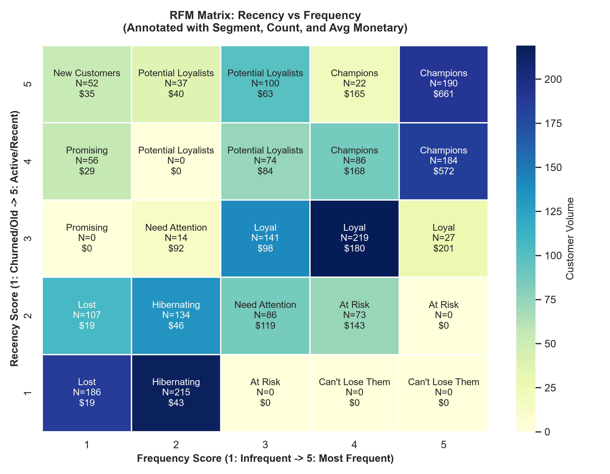
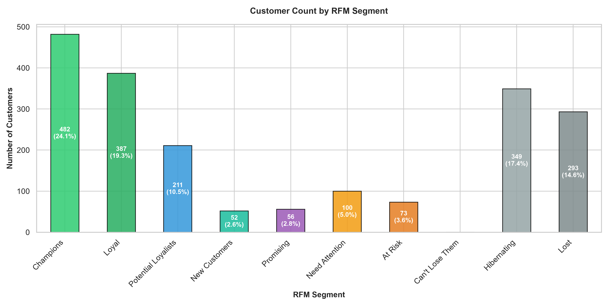
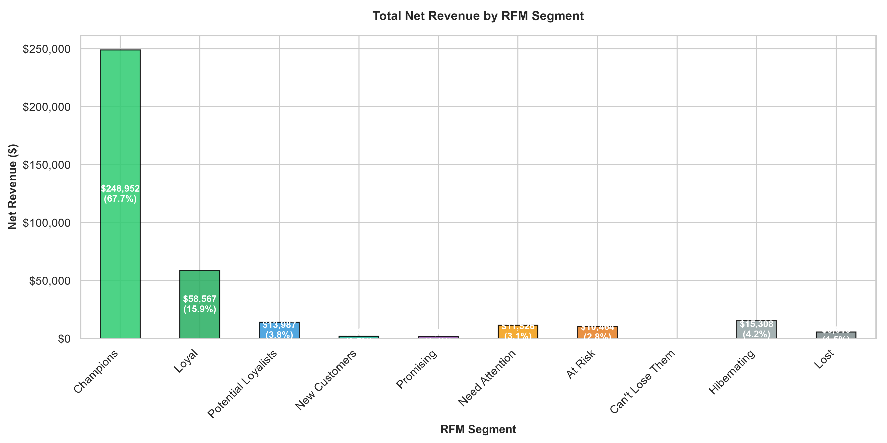
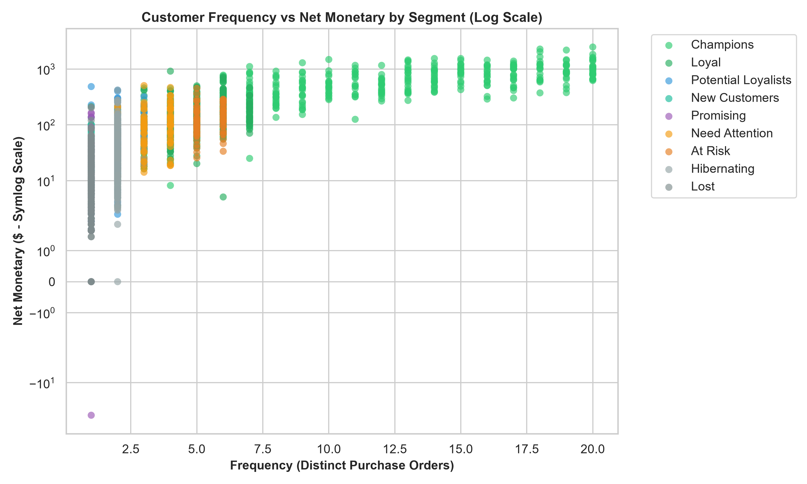
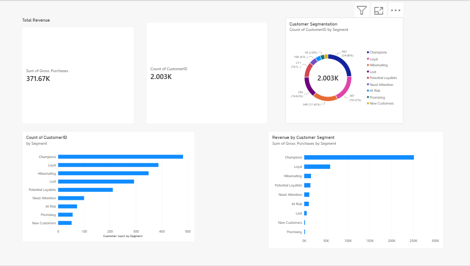

# Customer Segmentation using RFM (Recency, Frequency, Monetary)

An enterprise-grade, end-to-end analytical project demonstrating **Customer Segmentation using RFM Analysis** for retail and e-commerce. Built using Python, SQL (Window Functions & CTEs), Microsoft Power BI (DAX & Visuals), and Microsoft Excel (step-by-step formula audits).

---

## Project Highlights & Quick Links

- **Python Scoring & Visual Engine**: [`python/rfm_scoring.py`](python/rfm_scoring.py)
- **SQL NTILE(5) Model**: [`sql/rfm_ntile.sql`](sql/rfm_ntile.sql)
- **SQL vs Python Concordance Validator**: [`python/verify_sql.py`](python/verify_sql.py)
- **Power BI DAX Measures**: [`powerbi/dax_measures.dax`](powerbi/dax_measures.dax)
- **Power BI Dashboard Build Guide**: [`powerbi/dashboard_guide.md`](powerbi/dashboard_guide.md)
- **Power BI Segment Export**: [`powerbi/rfm_segments.csv`](powerbi/rfm_segments.csv)
- **Manual Validation Workbook (20 Customers)**: [`validation/manual_rfm_20_customers.xlsx`](validation/manual_rfm_20_customers.xlsx)
- **Edge Cases & Engineering Audit**: [`docs/edge_cases.md`](docs/edge_cases.md)

---

## 1. Project Overview & Architecture

RFM (Recency, Frequency, Monetary) is a cornerstone behavioral marketing model that segments customers by:
- **Recency (R)**: How recently did the customer purchase? (Lower days = higher engagement).
- **Frequency (F)**: How often do they buy? (Higher distinct orders = higher brand loyalty).
- **Monetary (M)**: How much net revenue do they contribute? (Gross purchases minus refunds).

```
                      +---------------------------------------+
                      | Raw Transactions (Online Retail Data) |
                      +---------------------------------------+
                                          |
                   [Drop Null IDs, Deduplicate, Separate Refunds]
                                          v
                      +---------------------------------------+
                      |       Cleaned Transaction Table       |
                      +---------------------------------------+
                                     /         \
                                    /           \
               [Python Pipeline: Pandas]     [SQL Engine: SQLite / Postgres]
               - Snapshot = Max Date + 1d    - Window NTILE(5) OVER Partition
               - rank(method='first')        - CASE Expression 10-Segment Map
               - pd.qcut(q=5, labels=1..5)   - Cross-Engine Comparison Query
                                    \           /
                                     \         /
                      +---------------------------------------+
                      |  Segment-Ready Data & Visual Assets   |
                      +---------------------------------------+
                       |                  |                  |
                       v                  v                  v
                 [Power BI]           [Excel 365]      [Docs & Charts]
              - DAX Measures       - 20 Sample Audit  - 4 High-Res PNGs
              - Executive Dash     - Step Formulas    - Edge Case Paper
```

---

## 2. Setup and Execution

### Prerequisites
- Python 3.10+ (Tested on Python 3.14)
- Git / PowerShell / Bash

### Quick Start
Clone or navigate to the project directory and run:

```bash
# 1. Install dependencies
pip install -r requirements.txt

# 2. Execute end-to-end Python RFM pipeline
python python/rfm_scoring.py

# 3. Run automated SQL validation & concordance audit
python python/verify_sql.py

# 4. Generate the 20-customer manual validation Excel workbook
python python/generate_validation_excel.py
```

---

## 3. Analytical Findings & Segment Breakdown

From an initial ingestion of **21,019 transactions**, **1,581 guest checkouts (7.52%)** without CustomerIDs and **47 duplicate records** were removed, leaving **19,391 verified transactions** across **2,003 unique customers** from Jan 1, 2025 to Dec 8, 2025 (Snapshot Date: Dec 9, 2025).

### Executive Financial & Segment Summary

| Segment | Customer Count | % of Customers | Net Revenue ($) | % of Revenue | Avg Recency (Days) | Avg Frequency (Orders) | Avg Ticket ($) |
| :--- | :---: | :---: | :---: | :---: | :---: | :---: | :---: |
| **Champions** | **482** | **24.06%** | **$248,952.35** | **67.67%** | **27.8** | **10.3** | **$516.50** |
| **Loyal** | **387** | **19.32%** | **$58,567.43** | **15.92%** | **105.3** | **4.5** | **$151.34** |
| **Hibernating** | 349 | 17.42% | $15,307.68 | 4.16% | 248.9 | 2.0 | $43.86 |
| **Potential Loyalists** | 211 | 10.53% | $13,987.21 | 3.80% | 19.5 | 2.0 | $66.29 |
| **Need Attention** | 100 | 4.99% | $11,526.20 | 3.13% | 187.2 | 3.3 | $115.26 |
| **At Risk** | 73 | 3.64% | $10,463.73 | 2.84% | 191.0 | 5.5 | $143.34 |
| **Lost** | 293 | 14.63% | $5,615.26 | 1.53% | 255.6 | 1.0 | $19.16 |
| **New Customers** | 52 | 2.60% | $1,826.20 | 0.50% | 18.3 | 1.0 | $35.12 |
| **Promising** | 56 | 2.80% | $1,625.45 | 0.44% | 30.6 | 1.0 | $29.03 |
| **Total / Overall** | **2,003** | **100.0%** | **$367,871.51** | **100.0%** | **127.5** | **4.5** | **$183.66** |

### Key Strategic Insights:
1. **Pareto Dominance (80/20 Rule Verified)**:
   - **Champions & Loyalists** represent **43.38%** of the customer base but drive **83.59% ($307,519.78)** of total company revenue.
2. **High-Value Churn Hazard**:
   - The **At Risk** segment contains customers with an average frequency of **5.5 orders** and high historic spend ($143.34 average ticket) who have not made a purchase in over **191 days**. Re-engaging this small group of 73 accounts can salvage **$10,463+** in annual revenue.
3. **New Customer Conversion Gap**:
   - **New Customers (52)** and **Promising (56)** customers purchased recently (18 to 30 days ago) with $29–$35 spend. Fast automated onboarding can double their repeat frequency.

---

## 4. Visualizations & Analytical Charts

The pipeline automatically outputs 300-DPI visual assets in both `docs/images/` and `powerbi/images/`:

### 1. Recency vs Frequency 5x5 Matrix Heatmap
Annotated with Segment Classifications, Volume (N), and Average Monetary Value:


### 2. Segment Size vs Revenue Contribution



### 3. Customer Frequency vs Monetary Scatter Plot (Symlog Scale)


---

## 5. Strategic Business Recommendations per Segment

| Segment | Profile | Actionable Marketing & Commercial Tactics | Channel / Cadence |
| :--- | :--- | :--- | :--- |
| **Champions** | Bought recently, buy often, highest spenders (\$516 avg ticket) | **VIP Concierge & Advocacy**: Early product access, dedicated support, referral ambassador rewards. Avoid discount spamming; offer value-add exclusivity. | Dedicated SMS / Direct Account Manager / Monthly VIP perks |
| **Loyal** | Regular recurring buyers, responsive to promotions (\$151 avg ticket) | **Upsell & Loyalty Tiers**: Tier-upgrade incentives, multi-pack bundles, cross-selling adjacent product lines based on past purchase history. | Bi-weekly Email / Loyalty Points statement |
| **Potential Loyalists** | Recent buyers with 2-3 orders, moderate spend | **Membership Enrollment**: Offer loyalty program enrollment, second-purchase thank-you discounts, and product usage guides to build habitual ordering. | Automated email trigger 7 days post-delivery |
| **New Customers** | Bought within the last 18 days, single order | **Onboarding Welcome Journey**: Send brand story, setup tutorial, customer care check-in, and a 14-day expiry coupon for order #2. | Welcome Email Series (Days 1, 3, 7, 14) |
| **Promising** | Recent single purchases, slightly longer gap (~30 days) | **Incentivized Discovery**: Recommend top-rated bestsellers; offer limited-time free shipping or small basket boosters. | Retargeting Ads + Email |
| **Need Attention** | Average recency and frequency, starting to drift (~187 days) | **Time-Limited Reactivation**: Re-engage with personalized recommendations based on previous categories and "We haven't seen you lately" perks. | Push notification / Targeted newsletter |
| **At Risk** | Historic high-value frequent buyers who haven't returned in 6+ months | **Urgent Win-Back Campaign**: Aggressive renewal offers, renewal discounts, customer satisfaction feedback surveys to identify dissatisfaction drivers. | High-priority Win-Back Email + Retargeting |
| **Can't Lose Them** | Top-tier spenders who have completely lapsed | **High-Touch Re-engagement**: Direct outreach from customer success or leadership; substantial reactivation credit; survey on product/service failure. | Personal email / Direct Mail |
| **Hibernating** | Low spend, low frequency, last bought >8 months ago | **Cost-Effective Clearance / Seasonal Campaigns**: Standard automated holiday/clearance campaigns. Avoid expensive paid retargeting. | Quarterly seasonal broadcast |
| **Lost** | Lowest scores across R, F, and M; inactive >250 days | **Sunset Policy**: Attempt one final reactivation blast; if unengaged, archive from active CRM to protect email deliverability and reduce ESP costs. | Sunset Email / Database Purge |

---

## 6. SQL vs Python Concordance & Tie Handling

A central feature of this project is the comparative analysis of quantile ranking methods:
- **Python**: Uses `rank(method='first')` followed by `pd.qcut()`.
- **SQL**: Uses `NTILE(5) OVER (ORDER BY Metric ASC, CustomerID ASC)`.

### Concordance Results (from `python/verify_sql.py`):
```
 Total_Customers  Segment_Matches  Segment_Mismatches  Match_Percentage  R_Score_Matches  F_Score_Matches  M_Score_Matches
            2003             1752                 251             87.47             1998             1568             2000
```
- **Recency Concordance**: **99.75%** (1,998 / 2,003 matches).
- **Monetary Concordance**: **99.85%** (2,000 / 2,003 matches).
- **Frequency Concordance**: **78.28%** (1,568 / 2,003 matches).

**Why do mismatches occur?**
Because Frequency is a discrete, low-cardinality integer with **642 customers having Frequency = 1** and **400+ customers having Frequency = 2**. When a discrete value spans across the 20% quintile boundary, `NTILE` splits rows based on physical sort order. Every mismatch is documented in [`validation/sql_python_mismatches.csv`](validation/sql_python_mismatches.csv) and analyzed in [`docs/edge_cases.md`](docs/edge_cases.md).

---

## 7. Manual Validation Workbook (Excel 365)

The file [`validation/manual_rfm_20_customers.xlsx`](validation/manual_rfm_20_customers.xlsx) contains 20 sample customer profiles and their raw transaction rows with dynamic Excel formulas:
- **Last Purchase Date**: `=MAXIFS(Customer_Transactions!$K$5:$K$300, Customer_Transactions!$G$5:$G$300, A8, Customer_Transactions!$D$5:$D$300, ">0")`
- **Recency Days**: `=ROUND(Snapshot_Date - Last_Purchase_Date, 1)`
- **Gross Purchases**: `=SUMIFS(Customer_Transactions!$I$5:$I$300, Customer_Transactions!$G$5:$G$300, A8, Customer_Transactions!$D$5:$D$300, ">0")`
- **Total Refunds**: `=ABS(SUMIFS(Customer_Transactions!$I$5:$I$300, Customer_Transactions!$G$5:$G$300, A8, Customer_Transactions!$D$5:$D$300, "<0"))`
- **Net Monetary**: `=SUMIFS(Customer_Transactions!$I$5:$I$300, Customer_Transactions!$G$5:$G$300, A8)`
- **Match Indicator**: `=IF(AND(ABS(Recency_Excel - Recency_PY)<=0.5, ABS(Monetary_Excel - Monetary_PY)<=0.05), "EXACT MATCH", "MISMATCH")`

## Dashboard Preview



All 20 sample records demonstrate a **100% exact numerical match** between Excel formulas and Python calculations.

---

## 8. Repository Structure

```
rfm-project/
├── data/
│   ├── online_retail_raw.csv           # Raw generated transaction dataset (21,019 rows)
│   ├── online_retail_cleaned.csv       # Cleaned deduplicated line items (19,391 rows)
│   ├── refunds_report.csv              # Audit log of all cancellations and returns
│   ├── rfm_results.csv                 # Customer-level RFM metrics, scores & segments
│   └── retail_rfm.db                   # SQLite database for relational validation
├── python/
│   ├── generate_dataset.py             # Deterministic synthetic retail dataset generator
│   ├── rfm_scoring.py                  # End-to-end cleaning, scoring & visual pipeline
│   ├── verify_sql.py                   # Automated SQL vs Python concordance auditor
│   └── generate_validation_excel.py    # Multi-tab openpyxl Excel formula workbook builder
├── sql/
│   └── rfm_ntile.sql                   # CTE & NTILE(5) SQL model with comparison query
├── powerbi/
│   ├── rfm_segments.csv                # Power BI segment-ready export
│   ├── dax_measures.dax                # Formatted DAX measures with ALLSELECTED/DIVIDE
│   ├── dashboard_guide.md              # Layout grid, exact hex palette & build manual
│   └── images/                         # Visual assets for dashboard integration
├── validation/
│   ├── manual_rfm_20_customers.xlsx    # Dynamic Excel audit sheet with native formulas
│   └── sql_python_mismatches.csv       # Audit trail explaining tie-break differences
├── docs/
│   ├── edge_cases.md                   # Comprehensive technical edge-case analysis
│   └── images/                         # High-res 300 DPI publication charts
├── README.md                           # Master project documentation
└── requirements.txt                    # Python environment specifications
```
